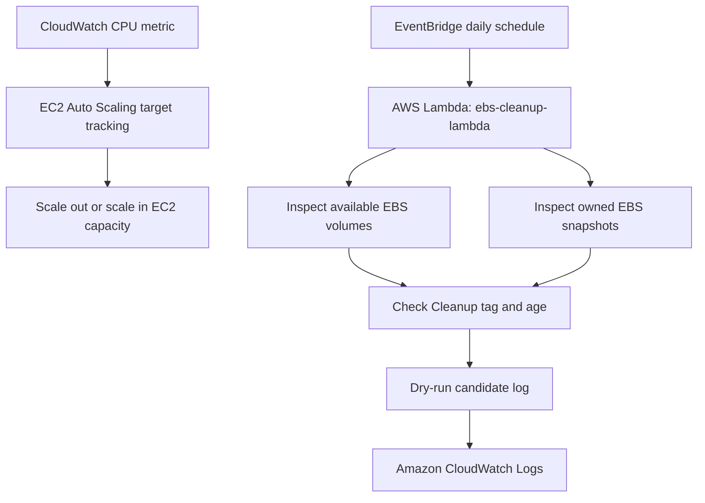
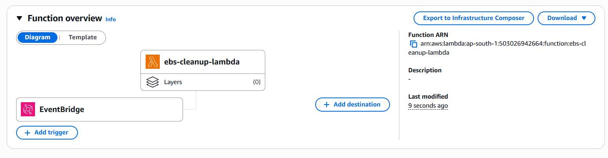
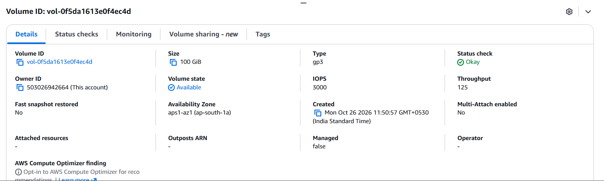
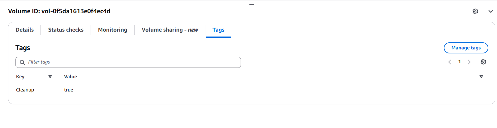
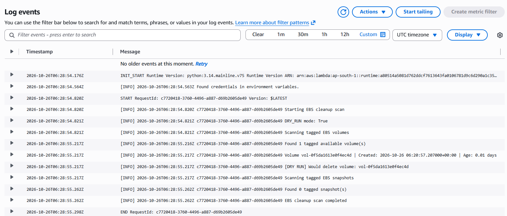
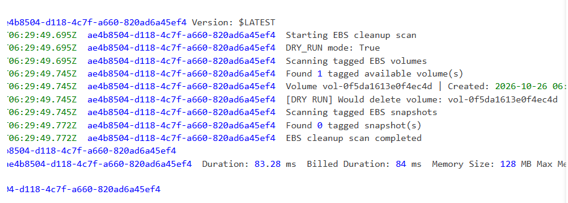

# AWS Cloud FinOps & Infrastructure Automation

A hands-on AWS project exploring workload-based EC2 scaling and scheduled EBS cleanup candidate detection. The goal is to align compute capacity with demand and identify tagged, aged storage resources for potential cleanup, using AWS-native automation and observability.

> **Implementation status:** EC2 Auto Scaling scale-out and scale-in were tested. The Lambda EBS cleanup workflow was tested in **dry-run mode** against a temporary tagged volume. Actual automated deletion has not been enabled or validated.

## Project objectives

- Demonstrate elastic compute capacity using EC2 Auto Scaling and CloudWatch metrics.
- Build a scheduled, serverless EBS cleanup scan using AWS Lambda and Boto3.
- Use tags and resource-age thresholds to determine cleanup candidates.
- Log execution details to CloudWatch and validate safely with dry-run behavior.

## AWS services and tools

- **Amazon EC2** — compute instances
- **EC2 Auto Scaling** — scale-out and scale-in
- **Amazon CloudWatch** — metrics and Lambda execution logs
- **AWS Lambda (Python / Boto3)** — EBS cleanup scan
- **Amazon EventBridge** — daily schedule for Lambda invocation
- **AWS IAM** — Lambda execution role and permissions
- **Amazon EBS** — volume and snapshot resources

## Features

### 1. EC2 Auto Scaling based on CloudWatch metrics

Configured a target-tracking scaling policy based on CPU utilization. The Auto Scaling Group was configured to adjust capacity as workload changed.

**Validation:** Observed scale-out from 1 to 2 EC2 instances and scale-in from 2 to 1. The project demonstrates capacity adjustment; cost savings were not separately measured.

### 2. Scheduled EBS cleanup candidate scan

Created a Lambda function named `ebs-cleanup-lambda` using Boto3. The function scans:

- **Volumes:** EBS volumes in `available` state tagged `Cleanup=true`; normal age threshold is 7 days.
- **Snapshots:** Snapshots owned by the account tagged `Cleanup=true`; normal age threshold is 30 days.

An EventBridge schedule invokes the Lambda daily. CloudWatch Logs records scan progress and candidate information.

### 3. Safe dry-run validation

The Lambda function uses `DRY_RUN = True`. During the test, a temporary EBS volume was tagged `Cleanup=true`. The test run found one tagged available volume and logged it as a deletion candidate without deleting it.

The temporary test bypass for the volume age check was used only to validate candidate detection for a newly created volume. The normal 7-day condition should be restored after the test. Keep dry-run enabled until actual deletion behavior has been deliberately reviewed and tested.

## Architecture / workflow

## Evidence

Screenshots from the implementation and dry-run validation are included below.

### Lambda function and schedule

### EBS volume used for validation

Volume details:

The cleanup tag used by the scan:

### Lambda dry-run execution

CloudWatch execution logs show that the function found one tagged available volume and identified it as a candidate:

Focused view of the dry-run candidate message:

## Measurable validation

- Auto Scaling validation: **1 → 2 → 1 EC2 instances**.
- Lambda dry-run validation: **1 tagged available EBS volume detected**.
- Deletion safety: **0 resources deleted during the dry-run test**.
- Normal cleanup thresholds: **7 days for volumes** and **30 days for snapshots**.
- Scheduled invocation: **daily** through EventBridge.

## Notes and limitations

- This is a learning project; it does not claim a measured percentage of AWS cost reduction.
- Lambda candidate detection was tested in dry-run mode. Automated deletion is not yet verified.
- Before enabling deletion, restore the age check, review IAM permissions, and test with disposable resources.
- Do not tag important production resources with `Cleanup=true` unless they are intentionally eligible for cleanup.
