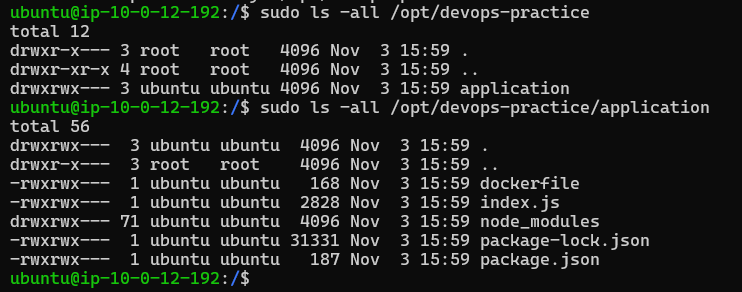
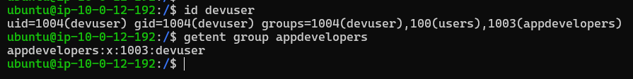
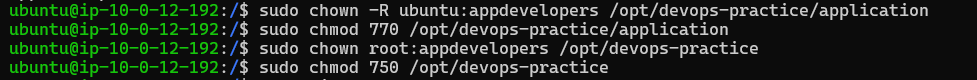
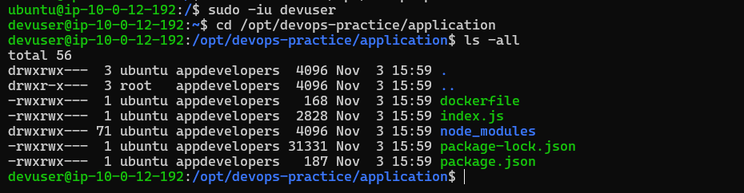
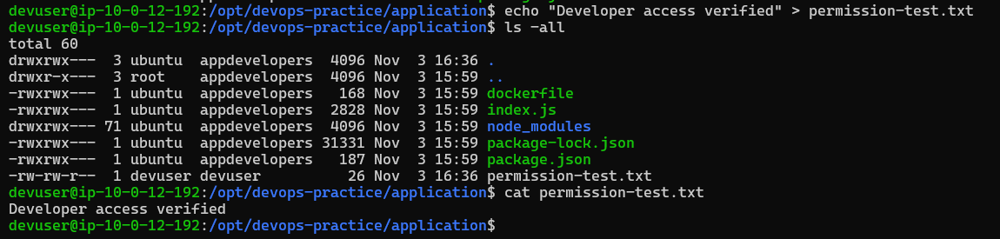
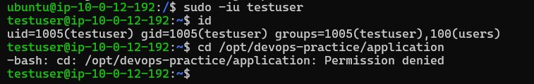
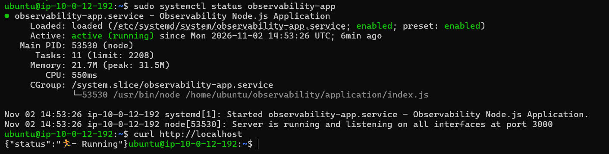

# Linux Administration

## Overview

This section covers hands-on Linux administration performed on an Ubuntu EC2 instance. The work focused on managing users and groups, implementing directory-level access control, configuring systemd services, and validating permissions through practical testing.

The objective was to understand how Linux access control and service management work in a real cloud-hosted environment.

## Environment

| Component | Details |
|---|---|
| Operating System | Ubuntu 24.04 LTS |
| Cloud Platform | AWS EC2 |
| Access Method | SSH |
| Application | Node.js |
| Service Manager | systemd |

---

## 1. Linux User and Group Management

Configured Linux users and groups to manage access to application-related directories.

Instead of assigning permissions individually to multiple users, a developer group was used to simplify access management.

### Tasks performed

- Created and configured a developer group.
- Managed directory access based on group membership.
- Used group-based permissions to separate authorized developers from other users.
- Verified access using different user contexts.



**Developer group configuration:**



### Why group-based access matters

Group-based permissions make access easier to maintain when multiple users require similar permissions. A user can be granted or revoked access by changing group membership rather than modifying permissions for every individual user.

---

## 2. File Ownership and Permission Management

Configured directory ownership and permissions to control who could access and modify application-related files.

Linux permissions were used to distinguish between:

- The file or directory owner
- The associated group
- Other users

### Tasks performed

- Inspected existing ownership and permissions.
- Modified ownership and group assignments.
- Configured directory permissions for authorized access.
- Validated access after changing permissions.



### Access validation

Permissions were tested using different user contexts to confirm that the configuration behaved as expected.

**Authorized developer access:**



**Developer write access:**



**Unauthorized access restriction:**



These tests verified that access was not determined solely by whether a user could log in to the server, but also by the permissions assigned to the relevant directory.

---

## 3. systemd Service Management

Configured the Node.js application to run as a systemd-managed service.

systemd allows applications to be managed consistently through Linux service-management commands instead of manually starting and stopping processes.



### Service management

Common commands used for managing and inspecting services:

```bash
# Check service status
sudo systemctl status nodejs

# Start the service
sudo systemctl start nodejs

# Stop the service
sudo systemctl stop nodejs

# Restart the service
sudo systemctl restart nodejs
```

### Why systemd was used

- Provides a consistent way to start and stop applications.
- Makes service status easier to inspect.
- Integrates application management with Linux.
- Supports investigation of service failures through system logs.

The Node.js and NGINX troubleshooting scenarios are documented separately in the **Troubleshooting** section.

---

## Key Skills Demonstrated

- Linux user and group administration
- File ownership and permission management
- Group-based access control
- Permission validation using different user contexts
- systemd service management
- SSH-based administration of Ubuntu EC2
- Practical application of least-privilege access principles

