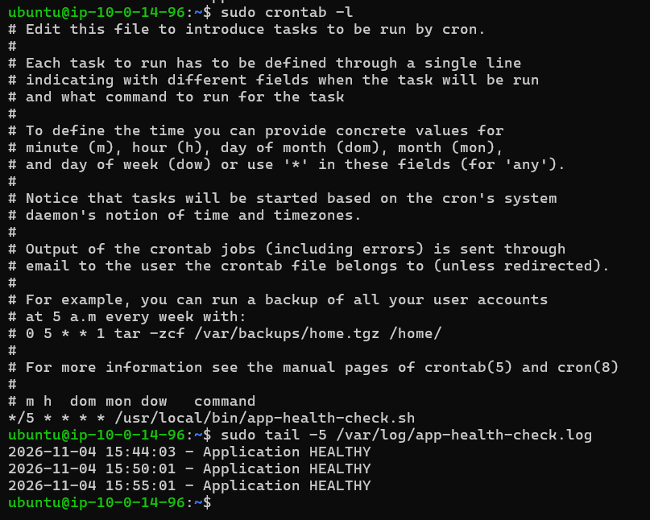
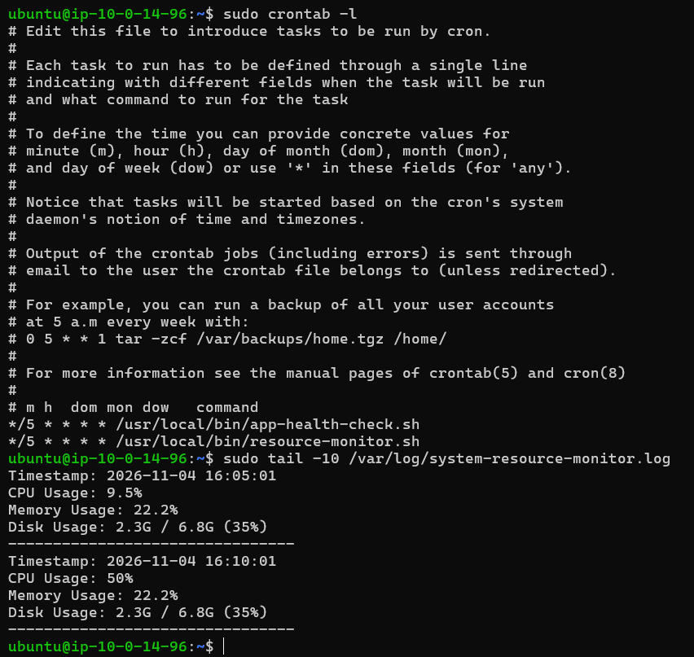

# Bash Automation & Cron

## Overview

This section documents Bash automation developed on an Ubuntu EC2 instance to automate application health checks and system resource monitoring.

The scripts were scheduled using Cron to run automatically every five minutes. Timestamped logs were used to record execution results and monitor application and system health.

## Environment

| Component | Details |
|---|---|
| OS | Ubuntu 24.04 LTS |
| Infrastructure | AWS EC2 |
| Scripting | Bash |
| Scheduling | Cron |
| Application | Node.js behind NGINX |
| Logs | `/var/log/` |

---

## 1. Automated Application Health Check

### Objective

Created a Bash script to periodically check whether the application was responding successfully.

The script sends an HTTP request to the application's health endpoint and records whether the application is healthy or unhealthy.

### Script: `app-health-check.sh`

Location:

```text
/usr/local/bin/app-health-check.sh
```

```bash
#!/bin/bash

LOG_FILE="/var/log/app-health-check.log"
URL="http://localhost/healthy"
TIMESTAMP=$(date '+%Y-%m-%d %H:%M:%S')

if curl -fsS --max-time 10 "$URL" > /dev/null; then
    echo "$TIMESTAMP - Application HEALTHY" >> "$LOG_FILE"
else
    echo "$TIMESTAMP - Application UNHEALTHY" >> "$LOG_FILE"
fi
```

### How it works

- `curl` sends a request to the health endpoint.
- `-f` treats HTTP error responses as failures.
- `-sS` suppresses normal output while displaying errors.
- `--max-time 10` limits how long the request can take.
- The timestamp records when the check was performed.
- The result is appended to the log file.

### Configure execution permissions

```bash
sudo chmod +x /usr/local/bin/app-health-check.sh
```

### Cron scheduling

Configured the script to run every five minutes using the root user's crontab:

```cron
*/5 * * * * /usr/local/bin/app-health-check.sh
```

Verify the scheduled job:

```bash
sudo crontab -l
```

### Execution evidence

The Cron schedule and health-check logs were verified.



Example log output:

```text
2026-11-04 15:44:03 - Application HEALTHY
2026-11-04 15:50:01 - Application HEALTHY
```

---

## 2. Automated System Resource Monitoring

### Objective

Created a Bash script to periodically record CPU, memory, and disk utilization.

This provides basic historical information about system resource usage through timestamped log entries.

### Script: `resource-monitor.sh`

Location:

```text
/usr/local/bin/resource-monitor.sh
```

```bash
#!/bin/bash

LOG_FILE="/var/log/system-resource-monitor.log"
TIMESTAMP=$(date '+%Y-%m-%d %H:%M:%S')

# CPU usage
CPU=$(top -bn1 | grep "Cpu(s)" | awk '{print 100 - $8 "%"}')

# Memory usage
MEMORY=$(free -h | awk '/Mem:/ {printf "%s / %s (%s)", $3, $2, $3/$2*100}')
MEMORY_PERCENT=$(free | awk '/Mem:/ {printf "%.1f%%", $3/$2*100}')

# Disk usage
DISK=$(df -h / | awk 'NR==2 {print $3 " / " $2 " (" $5 ")"}')

{
    echo "Timestamp: $TIMESTAMP"
    echo "CPU Usage: $CPU"
    echo "Memory Usage: $MEMORY_PERCENT"
    echo "Disk Usage: $DISK"
    echo "--------------------------------"
} >> "$LOG_FILE"
```

### Resource metrics collected

| Metric | Command | Purpose |
|---|---|---|
| CPU | `top` | Capture CPU utilization |
| Memory | `free` | Record memory usage |
| Disk | `df` | Record root filesystem usage |

### Cron scheduling

Configured the script to execute every five minutes:

```cron
*/5 * * * * /usr/local/bin/resource-monitor.sh
```

The scheduled execution was verified through Cron configuration and log output.



---

## 3. Automation Workflow

```text
Cron Scheduler
     |
     | Every 5 minutes
     |
     +----> Application Health Check
     |              |
     |              +----> HTTP request
     |              +----> HEALTHY / UNHEALTHY log
     |
     +----> Resource Monitoring
                    |
                    +----> CPU usage
                    +----> Memory usage
                    +----> Disk usage
                    +----> Timestamped log
```

## Key Skills Demonstrated

- Bash scripting
- HTTP health checks using `curl`
- Linux Cron scheduling
- CPU, memory, and disk monitoring
- Timestamped log generation
- Automated execution on Linux
- Basic application and system monitoring
