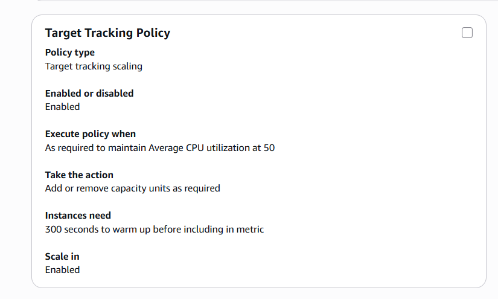
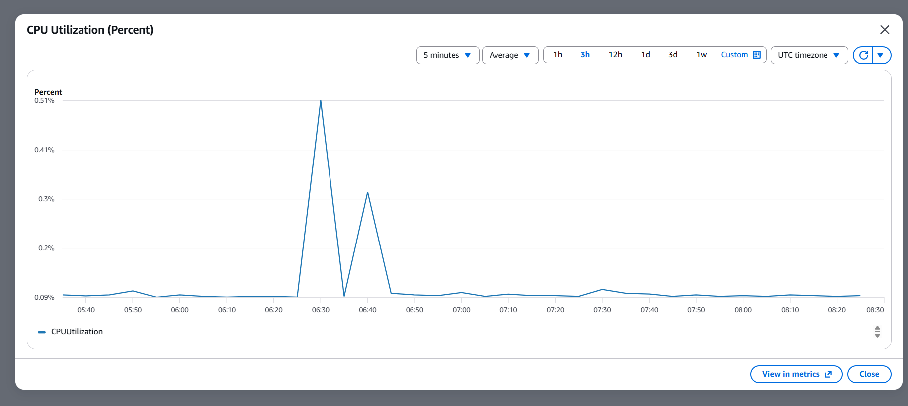

# AWS EC2 Auto Scaling & Cloud Resource Optimization

A hands-on AWS project demonstrating **dynamic EC2 capacity management** using an Auto Scaling Group and Amazon CloudWatch. The project configures target tracking to adjust instance capacity in response to average CPU utilization.

> **Validation status:** Scale-out and scale-in were previously observed, moving capacity from **1 → 2 → 1 EC2 instances**. This README is being expanded with screenshots of the current evidence-gathering run. The CPU-before-scale-out image is included; policy-triggered scale-out and scale-in screenshots will be added as captured.

## Project objectives

- Configure EC2 capacity to respond to workload changes rather than manually changing instance count.
- Use CloudWatch metrics with an EC2 Auto Scaling target tracking policy.
- Demonstrate both scale-out and scale-in.
- Record configuration and activity evidence for a reproducible cloud project.

## AWS services

- **Amazon EC2** — compute instances
- **EC2 Auto Scaling** — dynamic capacity management
- **Amazon CloudWatch** — CPU utilization metrics and scaling signals
- **AWS IAM** — permissions for the Auto Scaling service

## Implementation

### Target tracking policy

The Auto Scaling Group uses **Average CPU utilization** with a **50% target**. The policy is enabled, scale-in is enabled, and the instance warm-up period is **300 seconds**.

When average CPU utilization rises above the target, Auto Scaling can add instances. As utilization drops, the group can remove capacity, subject to the configured minimum and maximum capacity.

### Scaling validation

The behavior has been validated with capacity changing from **1 to 2 instances and back to 1**. The screenshots below document the evidence collected so far.

## Screenshots

> Image paths are relative to this README. Save the corresponding image files in `./screenshots/` using the filenames shown.

### Initial provisioning

The Activity History screenshot shows the initial group provisioning from 0 to 1 after a user request. This documents initial setup; it is **not** the policy-triggered scale-out event.

### Target tracking configuration

The policy is configured for average CPU utilization at 50%, with scale-in enabled and 300 seconds of instance warm-up.

### Before scale-out — CPU utilization

The CPU metric screenshot captured before the scale-out test shows low utilization, well below the 50% target.

### After scale-out

Add the screenshot after the scaling policy launches a second instance:

- `autoscaling-after-scale-out.png` — Auto Scaling Group or EC2 view showing two instances.
- `autoscaling-scale-out-activity.png` — Activity History entry indicating the policy-driven scale-out.

### Scale-in

Add the screenshots after the workload subsides and the group scales back down:

- `autoscaling-before-scale-in.png` — two instances before scale-in.
- `autoscaling-after-scale-in.png` — one instance after scale-in.
- `autoscaling-scale-in-activity.png` — Activity History entry for the scale-in event.

## Measurable outcomes

- **CPU target:** 50% average utilization.
- **Capacity test:** 1 → 2 → 1 EC2 instances.
- **Instance warm-up:** 300 seconds.
- **Scaling actions:** scale-out and scale-in observed.

No specific percentage of cost savings is claimed because cost reduction was not separately measured. The project demonstrates elastic capacity management that can help avoid maintaining excess compute capacity during lower demand.

## Notes

- Scaling is constrained by the Auto Scaling Group's configured minimum and maximum capacity.
- For a convincing demonstration, capture the Activity History entry that explicitly shows the scaling policy action; distinguish it from initial user-requested provisioning.
