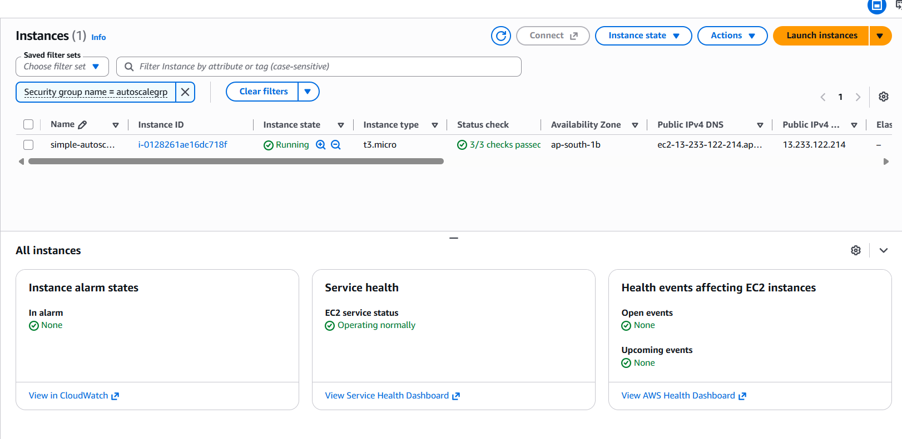
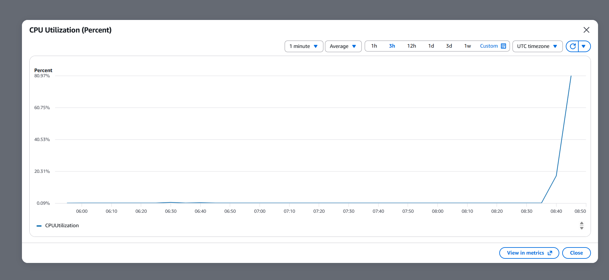
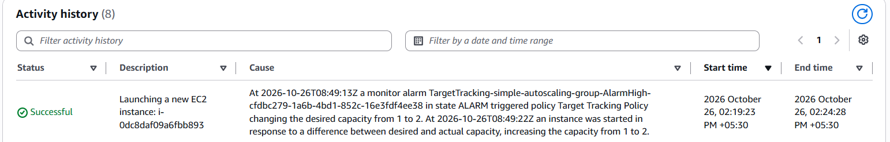
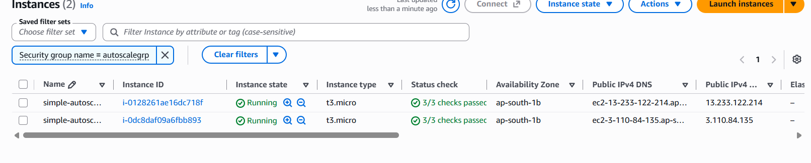

# AWS EC2 Auto Scaling & Cloud Resource Optimization

A hands-on AWS project demonstrating **dynamic EC2 capacity management** using an Auto Scaling Group and Amazon CloudWatch. The group adjusts compute capacity in response to CPU utilization, helping align provisioned resources with workload demand.

> **Current validation:** The target tracking policy automatically scaled the group from **1 to 2 EC2 instances** when CPU utilization rose above its 50% target. Both instances subsequently reached **3/3 status checks passed**. Scale-in evidence will be added after the next test.

## Project goals

- Configure EC2 Auto Scaling to respond to workload changes without manually changing desired capacity.
- Use CloudWatch CPU metrics with a target tracking scaling policy.
- Validate automatic scale-out and scale-in behavior.
- Capture AWS console and metric evidence for a reproducible project demonstration.

## AWS services

- **Amazon EC2** — virtual machine instances
- **EC2 Auto Scaling** — automatic capacity adjustment
- **Amazon CloudWatch** — CPU utilization metrics and scaling signals
- **AWS IAM** — permissions used by the Auto Scaling configuration

## Architecture and scaling behavior

The EC2 instances are managed by an Auto Scaling Group. A CloudWatch-backed **Target Tracking Scaling Policy** maintains average CPU utilization around **50%**.

- When average CPU utilization rises above the target, the policy can increase desired capacity.
- When demand falls and utilization remains below the target, the policy can reduce capacity, subject to group settings.
- The policy has **scale-in enabled** and an instance warm-up period of **300 seconds**.
- The group is configured with capacity limits to control the number of instances.

## Implementation evidence

Screenshots are stored in `./screenshots/`. The image filenames below are the expected README references; make sure your local files use these names.

### 1. Initial provisioning

The Activity History record documents the initial capacity change from 0 to 1 after a user request. This is initial provisioning evidence, **not** the automatic scale-out event.

### 2. Target tracking policy

The policy is enabled and targets average CPU utilization of 50%. Scale-in is enabled, with 300 seconds of instance warm-up.

### 3. Before scale-out — one instance

The initial EC2 state shows one running instance before the CPU load test.

### 4. CPU utilization rises above target

During the load test, CloudWatch CPU utilization reached approximately **80.97%**, exceeding the configured 50% target.

### 5. Automatic scale-out — Activity History

The Activity History shows the target tracking policy changing desired capacity from **1 to 2** and launching another EC2 instance. This is evidence of policy-triggered scaling, rather than a manual capacity change.

### 6. After scale-out — two healthy instances

The Auto Scaling Group reached two running EC2 instances. Both instances show **3/3 status checks passed**.

## Measurable outcomes

| Measure | Observed result |
|---|---|
| CPU target tracking threshold | 50% average CPU utilization |
| CPU during scale-out test | Approximately 80.97% |
| Capacity before scale-out | 1 EC2 instance |
| Capacity after scale-out | 2 EC2 instances |
| Instance health after scale-out | Both instances passed 3/3 status checks |
| Instance warm-up configured | 300 seconds |
| Scale-in | Previously validated; current evidence to be added |

The project demonstrates elastic capacity management that can help reduce unnecessary compute capacity during lower demand. **No specific cost savings percentage is claimed**, because actual cost reduction was not measured.

## Scale-in evidence — pending

After the test workload stops and CPU utilization falls, the Auto Scaling Group should scale in automatically. Add the screenshots from that phase:

- `autoscaling-cpu-before-scale-in.png` — CPU utilization returning below target.
- `autoscaling-scale-in-activity.png` — Activity History entry showing policy-driven scale-in.
- `autoscaling-after-scale-in.png` — one instance remaining and healthy after scale-in.

## Notes

- Do not manually terminate an instance or change desired capacity during the evidence capture; let the scaling policy perform the action.
- Distinguish the initial user-requested provisioning event from the policy-triggered scale-out activity.
- Scaling behavior depends on CloudWatch metric evaluation, instance warm-up, cooldown behavior, and the Auto Scaling Group's minimum and maximum capacity.
