# Linux & Application Troubleshooting

## Overview

This section documents practical troubleshooting scenarios performed on an Ubuntu EC2 instance running a Node.js application behind NGINX.

The exercises involved investigating systemd errors, service failures, HTTP 502 responses, application logs, listening addresses, and CPU and memory utilization.

The troubleshooting process focused on identifying symptoms, investigating relevant system information, determining the underlying cause, applying corrective actions, and verifying recovery.

## Environment

| Component | Details |
|---|---|
| OS | Ubuntu 24.04 LTS |
| Infrastructure | AWS EC2 |
| Application | Node.js |
| Reverse Proxy | NGINX |
| Service Management | systemd |
| Logging | journalctl, NGINX logs |

---

## 1. Troubleshooting systemd Service Failures

### Investigating a working-directory error

Encountered a systemd service startup failure related to the application's working directory (`chdir`).

The service was unable to start correctly, so its status and logs were inspected to investigate the configuration issue.

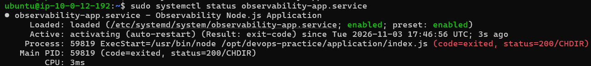

### Investigation commands

```bash
sudo systemctl status nodejs
sudo journalctl -u nodejs
sudo journalctl -u nodejs -n 50
```

The investigation involved checking the service configuration and its working-directory settings.

### Service recovery

After addressing the service configuration issue, the application service was recovered and its status verified.

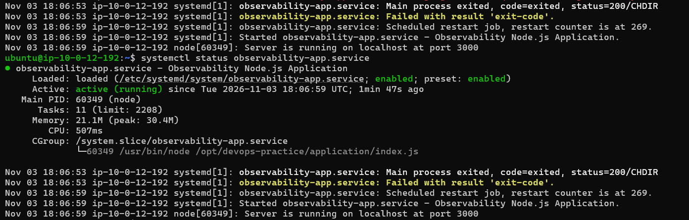

---

## 2. Investigating Service Logs and Permission Errors

Linux service logs are an important source of information when diagnosing application failures.

During the exercise, a permission-related error was encountered while accessing service logs.

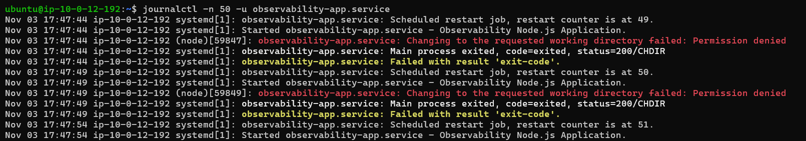

### Commands for log investigation

```bash
# Inspect service status
sudo systemctl status nodejs

# View service logs
sudo journalctl -u nodejs

# View recent logs
sudo journalctl -u nodejs -n 50

# Follow logs in real time
sudo journalctl -u nodejs -f
```

This exercise involved investigating service logs and understanding the permissions required to access system-level information.

---

## CPU and Memory Stress Testing — Application Reliability

### Objective
Validate whether the EC2 instance and the Node.js application behind NGINX remain responsive during simulated CPU and memory pressure.

### 1. Simulate CPU and Memory Pressure

Used `stress-ng` to generate CPU and memory pressure on the EC2 instance. Monitored system resource utilization using `top`.

```bash
top
```

During the test:
- CPU utilization reached 100%.
- Two CPU stress workers consumed approximately 52% CPU each.
- The memory stress process used approximately 500 MiB of resident memory.
- Approximately 839 MiB of memory remained available.

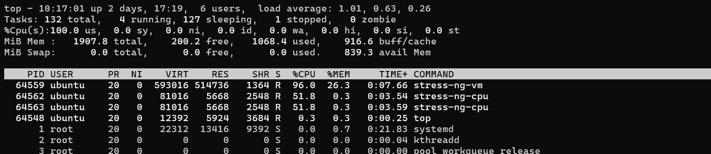

### 2. Test HTTP Availability from the Local Machine

While the EC2 instance was under resource pressure, sent HTTP requests from my local machine to the EC2 public IP through NGINX.

```bash
for i in {1..10}; do
    curl -s -o /dev/null -w "HTTP: %{http_code} | %{time_total}s\n" http://EC2_PUBLIC_IP/
done
```

### Test Results

| Metric | Result |
|---|---:|
| HTTP requests sent | 10 |
| Successful responses | 10/10 |
| HTTP status | 200 |
| Average response time | 98.6 ms |
| Minimum response time | 85.7 ms |
| Maximum response time | 115.2 ms |

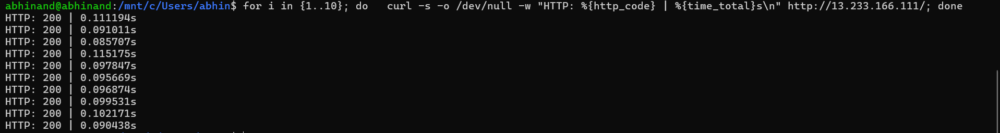

### Outcome

Despite high CPU utilization and memory pressure, all 10 HTTP requests returned **HTTP 200**, with an average response time of approximately **98.6 ms**.

This test demonstrated that the application remained responsive during the simulated resource-pressure scenario.

## 3. Troubleshooting NGINX 502 Bad Gateway

### Problem

The Node.js application was deployed behind NGINX as a reverse proxy on an EC2 instance.

When accessing the **EC2 public IP address through port 80**, the browser displayed an NGINX `502 Bad Gateway` error.

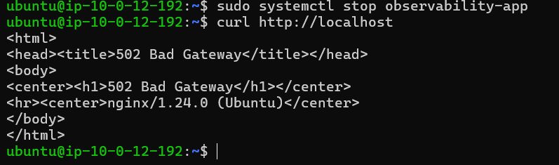

NGINX was running and accepting incoming HTTP requests. However, the application behind the reverse proxy was unavailable.

### Investigation

The investigation involved checking both NGINX and the Node.js application.

```bash
# Check Node.js service
sudo systemctl status nodejs

# Check NGINX service
sudo systemctl status nginx

# Inspect Node.js logs
sudo journalctl -u nodejs -n 50

# Inspect NGINX error logs
sudo tail -n 50 /var/log/nginx/error.log

# Check listening ports
sudo ss -tulpn
```

### Identifying the root cause

The investigation revealed that **the Node.js service was stopped while NGINX remained running**.

The request flow was:

1. The browser sent an HTTP request to the EC2 public IP on port 80.
2. NGINX accepted the incoming request.
3. NGINX attempted to forward the request to the Node.js upstream application.
4. The Node.js service was not running.
5. NGINX returned a `502 Bad Gateway` response.

This demonstrated how an application failure can result in an HTTP error even when the reverse proxy itself is operational.

### Node.js service investigation

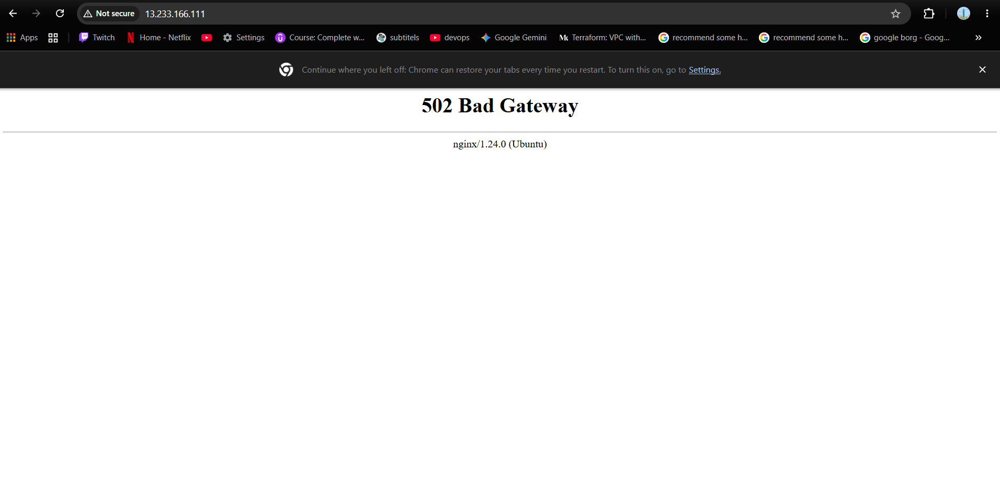

Service logs were inspected to investigate the stopped application.

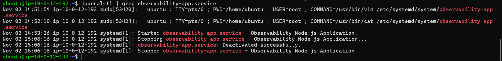

### NGINX error log investigation

NGINX error logs were examined to understand why the upstream application could not be reached.

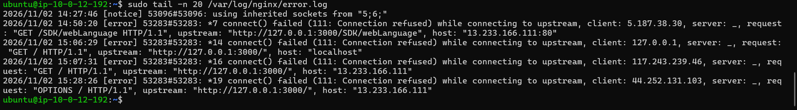

### Recovery and validation

The Node.js service was recovered, and its status was verified.

```bash
sudo systemctl restart nodejs
sudo systemctl status nodejs
```

The application was then tested again through NGINX.

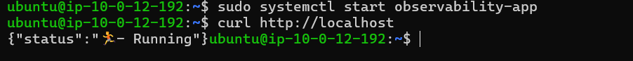

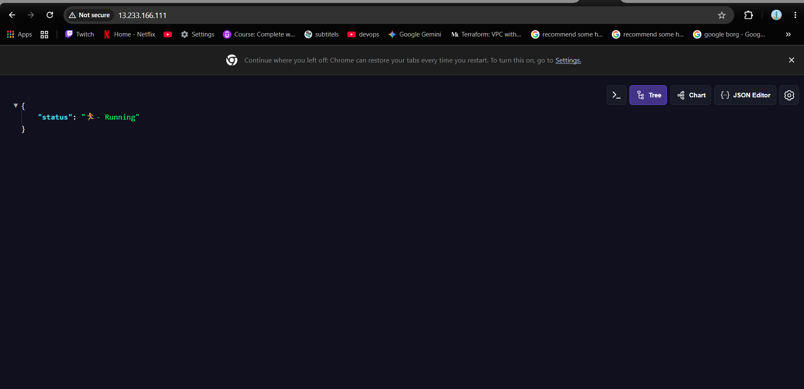

### Key learning

An NGINX `502 Bad Gateway` error does not necessarily mean NGINX itself has failed.

When NGINX is operational but the application is unavailable, troubleshooting should include:

- Upstream application service status
- Application logs
- NGINX error logs
- Application listening address and port
- Connectivity between NGINX and the application

---

## 4. Investigating Node.js Listening Addresses

The Node.js application was tested with different listening configurations to understand the difference between binding to localhost and binding to all network interfaces.

### Localhost-only binding


### Listening on all interfaces


### Verification

The listening address and port were inspected using:

```bash
sudo ss -tulpn
```

This helped demonstrate how the application's binding address affects where it can accept connections.

The application was also accessed through NGINX:


---

## 5. CPU Resource Investigation

CPU stress testing was performed to observe resource utilization and system behavior under increased load.

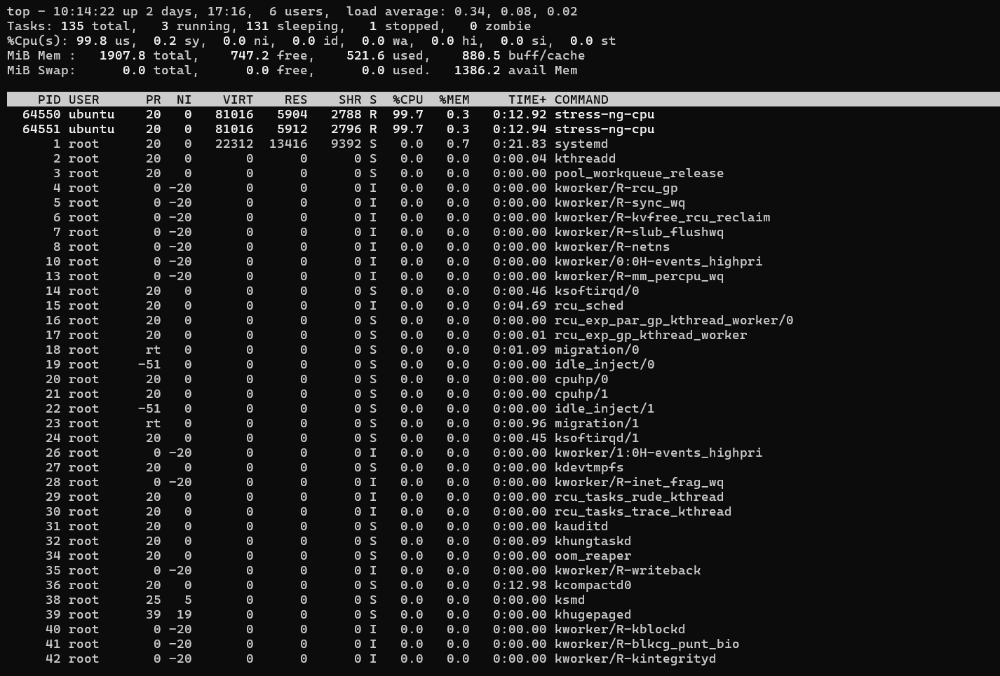

### Investigation commands

```bash
# View CPU and process activity
top

# Inspect load average
uptime

# Find CPU-intensive processes
ps aux --sort=-%cpu | head
```

This exercise helped connect Linux resource monitoring with the EC2 Auto Scaling work documented separately.

---

## 6. Memory Usage Investigation and Recovery

A controlled memory allocation test was used to investigate process-level memory usage.

### Baseline

System memory usage was inspected before introducing the test workload.

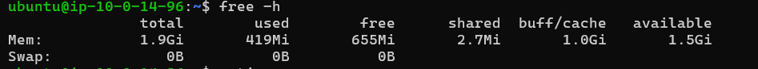

### Detecting increased memory usage

A controlled process allocated approximately 200 MiB of memory. Memory usage and process activity were inspected during the test.

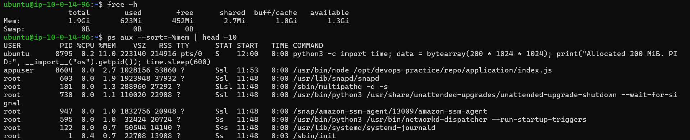

### Process investigation

The process was investigated using Linux memory and process information.


Commands used during the investigation:

```bash
# Inspect memory usage
free -h

# Identify memory-intensive processes
ps aux --sort=-%mem | head

# Inspect process details
cat /proc/<PID>/status
```

### Recovery

The test process was terminated, and memory usage was checked again to confirm recovery.

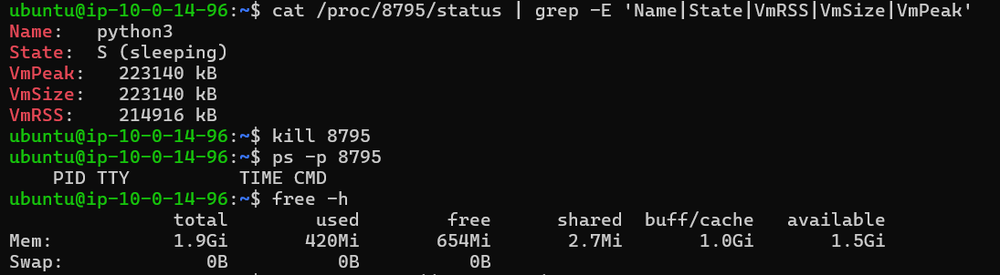

This was a controlled process-level memory investigation. It was not a system-wide out-of-memory event.

---

## Key Skills Demonstrated

- Linux service troubleshooting using systemd
- Application log investigation using journalctl
- Investigating systemd working-directory errors
- Linux permission troubleshooting
- NGINX reverse proxy troubleshooting
- HTTP 502 investigation and root cause identification
- Node.js service recovery
- Process and listening-port inspection
- CPU and memory utilization investigation
- Controlled resource testing and recovery
- Application health verification after troubleshooting
